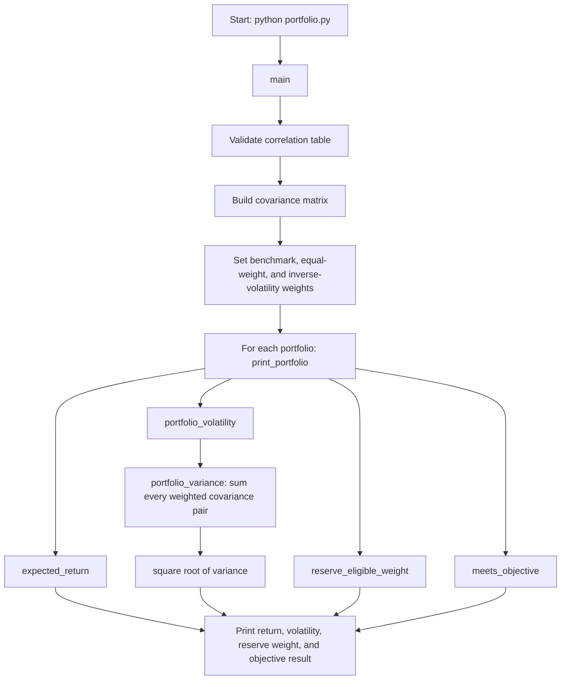

# Lab 15 - Portfolio Search Project

## Purpose and disclosure

Built with AI help as a learning demonstration, not investment advice. Historical returns estimated from five years of monthly adjusted-close prices are history, not forecasts.

## Meridian training mandate

| Input | Value |
|---|---:|
| Assets | Treasury bills, Treasury 10-year note, investment-grade bond fund, global equity index fund |
| Objective return | 6.5% |
| Minimum reserve-eligible weight | 3.0% |
| Reserve-eligible sleeves | Treasury bills and Treasury 10-year note |
| Search rule | Long-only weights in 5-percentage-point steps |

## Meridian inputs

| Sleeve | Expected return | Volatility |
|---|---:|---:|
| Treasury bills | 3.5% | 0.5% |
| Treasury 10-year note | 4.3% | 7.0% |
| Investment-grade bond fund | 5.0% | 6.0% |
| Global equity index fund | 8.0% | 16.0% |

| Correlation | Bills | 10-year | IG bonds | Equity |
|---|---:|---:|---:|---:|
| Bills | 1.00 | 0.10 | 0.05 | 0.00 |
| 10-year | 0.10 | 1.00 | 0.80 | -0.10 |
| IG bonds | 0.05 | 0.80 | 1.00 | 0.25 |
| Equity | 0.00 | -0.10 | 0.25 | 1.00 |

## Known-answer check

| Portfolio | Weights: bills / 10-year / IG / equity | Expected return | Volatility | Reserve-eligible | Meets 6.5%? |
|---|---|---:|---:|---:|---|
| Benchmark | 0.0% / 0.0% / 40.0% / 60.0% | 6.80% | 10.46% | 0.0% | Yes |
| Equal weight | 25.0% / 25.0% / 25.0% / 25.0% | 5.20% | 5.21% | 50.0% | No |
| Inverse volatility | 84.3% / 6.0% / 7.0% / 2.6% | 3.77% | 1.05% | 90.3% | No |

All values match the expected Lab 14 results.

## Lowest-risk search results

The app searches every long-only allocation in 5% steps, retains only allocations that meet the return objective and reserve constraint, and chooses the allocation with the lowest volatility.

| Run | Weights: bills / 10-year / IG / equity | Expected return | Volatility |
|---|---|---:|---:|
| Meridian inputs as loaded | 0% / 20% / 25% / 55% | 6.51% | 9.44% |
| Equity expected return edited from 8.0% to 7.0% | 0% / 10% / 10% / 80% | 6.53% | 12.94% |

The largest weight change is 25 percentage points.

## Correlation sensitivity test

I temporarily changed the investment-grade bond fund / equity correlation from 0.25 to 0.50 in both symmetric correlation-table cells. The lowest-risk answer changed to:

| Weights: bills / 10-year / IG / equity | Expected return | Volatility |
|---|---:|---:|
| 0% / 40% / 0% / 60% | 6.52% | 9.73% |

I then restored the original 0.25 correlation in `portfolio.py`. This confirms the Streamlit app uses the calculations imported from `portfolio.py`; it does not contain a second copy of the portfolio math.

## My fund universe

This project universe uses Nike, Inc. (NKE) as the equity sleeve.

| Ticker | Fund | Role |
|---|---|---|
| BIL | SPDR Bloomberg 1-3 Month T-Bill ETF | Cash and reserve |
| IEF | iShares 7-10 Year Treasury Bond ETF | Government bonds |
| LQD | iShares iBoxx $ Investment Grade Corporate Bond ETF | Fixed income |
| NKE | Nike, Inc. | Equity (single-company stock) |

`prices.csv` contains 60 completed monthly adjusted-close prices, date first and oldest month first, from October 2021 through September 2026. `prices_sources.md` records the Yahoo Finance source and download date for each ticker. NKE is a stock rather than a fund, so its use as the equity sleeve should be confirmed against the instructor's universe requirements.

## CSV estimates

For an uploaded `prices.csv`, `portfolio.py` calculates:

- Monthly return: `(current adjusted close / previous adjusted close) - 1`
- Historical expected-return estimate: `mean monthly return x 12`
- Annualized volatility: `sample monthly standard deviation x sqrt(12)`
- Correlation from the monthly-return series

The functions can use every available month or only the last 36 monthly returns.

## Run the Streamlit app

```powershell
cd C:\Users\radys\FIN43900-Fall2026
.\.venv\Scripts\Activate.ps1
python -m streamlit run app.py
```

The sidebar contains the objective return, reserve minimum, CSV upload, and last-36-month switch. The page shows editable expected-return inputs, reserve-eligibility checkboxes, the lowest-risk current mix, the as-loaded answer, and the largest weight change.

## portfolio.py flowchart



## Your call

**Pilot, not adopt:** The app's starting mix is 0% bills, 20% 10-year notes, 25% investment-grade bonds, and 55% equity. It meets the 6.5% target at 6.51%, but the result is fragile: lowering the equity estimate by one point shifts 25 percentage points of the allocation. I would adopt it only after the decision-maker confirms that the 8.0% equity-return estimate is an appropriate planning assumption.
